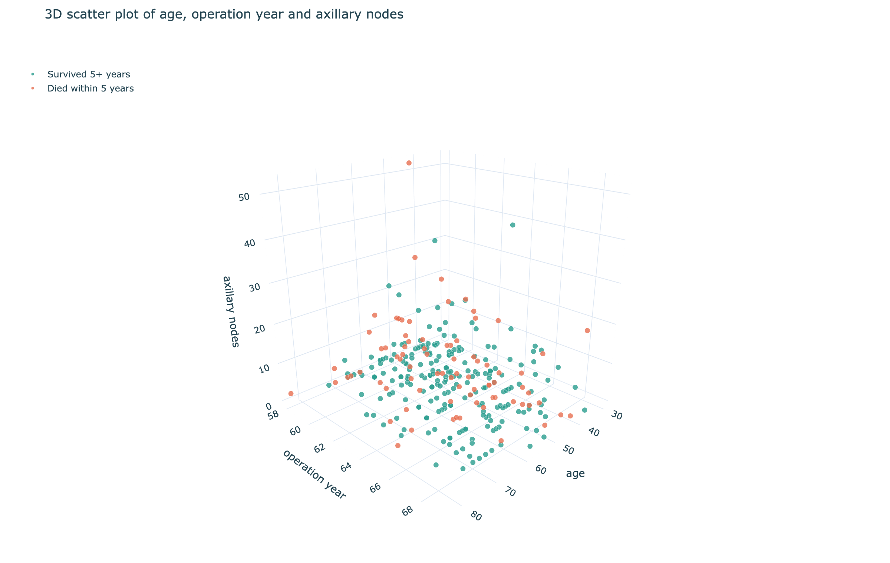

# Haberman's Survival Data: Exploratory Data Analysis 📊

Exploratory analysis of the Haberman dataset: 306 patients who had breast cancer surgery at the University of Chicago's Billings Hospital (1958–1970).
The goal is to see which features (age, year of operation, number of positive axillary nodes) help tell apart patients who survived 5+ years from those who did not.

## 🛠️ Technologies
Python · Pandas · NumPy · Matplotlib · Seaborn · Plotly · Jupyter Notebook

## 📂 Files
| File | What it is |
|---|---|
| `Haberman.ipynb` | The full analysis notebook |
| `Haberman.csv` | The dataset (no header row) |
| `scatter_3d.html` | Interactive 3D plot |

## 🔍 What the notebook covers
- Data loading, shape, class balance (225 survived vs 81 died, about 73.5% / 26.5%) and duplicates
- Univariate analysis: histograms, PDFs, CDFs, box plots, violin plots
- Bivariate analysis: coloured scatter plots, pair plots and contour plots
- 3D scatter plot of all three features
- Observations and conclusions

## 📌 Key findings
- **Axillary nodes is the most useful feature.** Patients who survived have a median of 0 nodes; those who died have a median of 4.
- Survival falls as nodes rise: about 86% with 0 nodes, 75% with 1–3, 61% with 4–10 and 42% with more than 10.
- Age and operation year barely separate the two classes.
- The classes overlap heavily, so no simple rule separates them cleanly.

## 🧊 3D scatter plot


**[Open the interactive version](https://nabilatarannum.github.io/Data_Analysis/scatter_3d.html)** (rotate, zoom, click the legend to hide a class).

## ▶️ Run it yourself
```bash
pip install pandas numpy matplotlib seaborn plotly kaleido nbformat
jupyter notebook Haberman.ipynb
```
