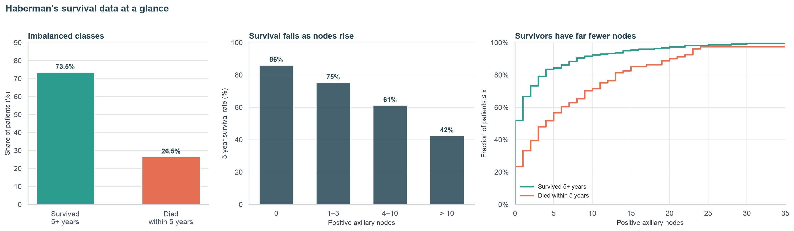

# Data Analysis Projects 📊

Welcome to my Data Analysis repository! Here I document my projects on data cleaning, exploration and visualization using Python.

## 🛠️ Technologies
Python · Pandas · NumPy · Matplotlib · Seaborn · Plotly · Jupyter Notebook

## 📂 Projects

### 1. Haberman's Survival Data: Exploratory Data Analysis
Exploratory analysis of 306 patients who had breast cancer surgery, looking at which features (age, year of operation, positive axillary nodes) help tell apart those who survived 5+ years from those who did not.

- **Skills shown:** data cleaning, univariate and bivariate analysis, PDFs/CDFs, pair plots, contour plots, 3D plotting, drawing conclusions from data
- **Main finding:** the number of axillary nodes is the most useful feature; age and operation year barely separate the classes
- 👉 **[Open the project folder](Haberman/)** (notebook, data, report and interactive 3D plot)

---

More projects will be added as I continue to learn and build!
